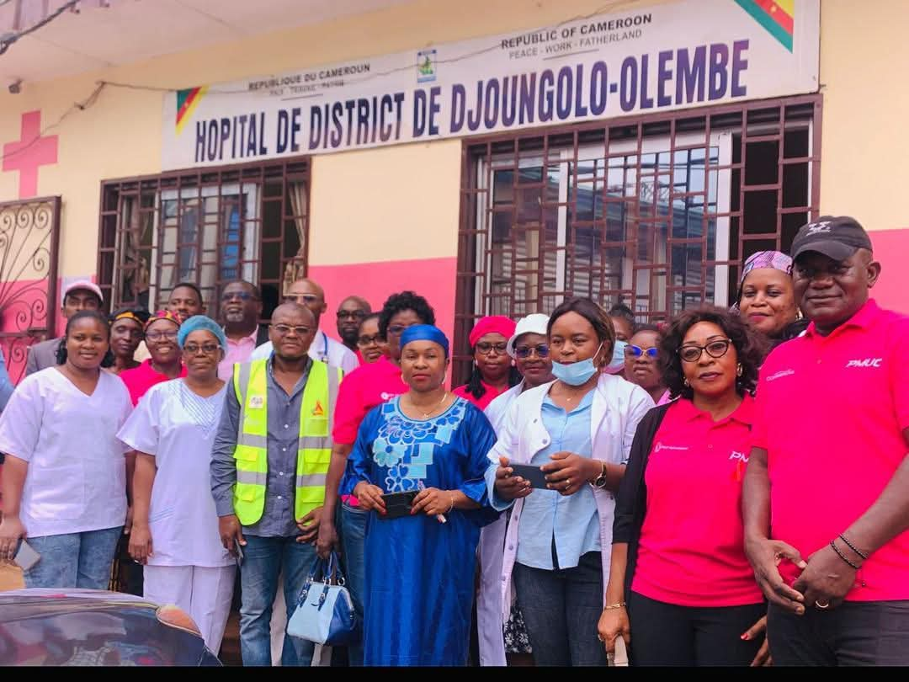
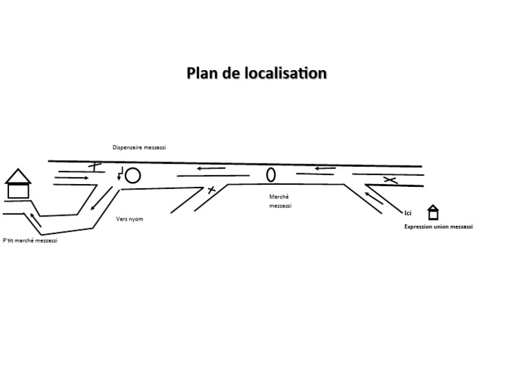
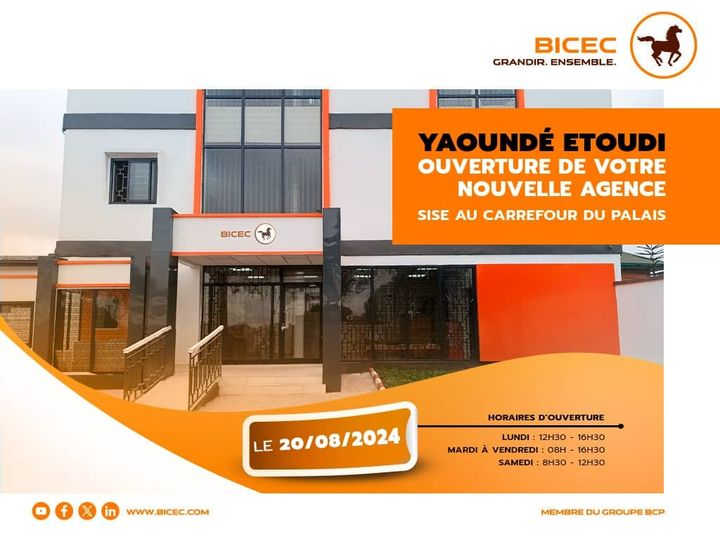

# Nouveaux recoupements — 15 novembre 2026

## 1. Dispensaire : façade identifiable trouvée

Source : Echos Santé, article publié le 16 mars 2026 :
https://echosante.info/hopital-de-district-de-djoungolo-olembe-la-metamorphose-qui-redonne-espoir/

Image originale : https://echosante.info/wp-content/uploads/2026/03/redonne.png
1080 × 810, date exacte de prise de vue non donnée, crédit photographique non précisé dans l'article.
**Référence de presse uniquement ; aucune licence libre établie, ne pas intégrer comme texture.**

L'enseigne est lisible : HOPITAL DE DISTRICT DE DJOUNGOLO-OLEMBE. La façade est crème avec soubassement rose et grilles bordeaux. Le directeur interrogé confirme l'ancienne appellation de dispensaire Messassi et situe l'établissement sur l'axe lourd, à Olembé après Messassi. Il décrit une grande plaque à l'entrée ainsi qu'une inscription sur le bâtiment à étage, visibles depuis le carrefour.

**Ce que cela résout :** reconnaître le bâtiment et son nom actuel.
**Ce que cela ne résout pas :** position du taxi, orientation de l'entrée par rapport à la chaussée et emplacement exact de la bifurcation. La photo est rapprochée, sans vue large de la route.

## 2. Plan schématique trouvé

Source : https://fr.scribd.com/document/940651081/Plan-de-Localisation
Mis en ligne par bilbert7.ndongo ; titre de la plateforme amélioré par IA ; auteur et date du dessin non établis.
768 × 543. Tous droits réservés selon la page. **Référence uniquement.**

Le dessin place des repères nommés dispensaire Messassi, marché Messassi, petit marché, direction Nyom et « Expression union messassi ». Le repère « Ici » désigne une destination liée à ce dernier libellé, pas nécessairement le dispensaire.
Ne pas lire les cercles schématiques comme preuve de vrais ronds-points. Pas d'échelle ni de nord : ne pas convertir directement en coordonnées.

## 3. Repère de l'arrivée : façade BICEC Étoudi

Source primaire : https://www.bicec.com/images/actu/20-aout-2024.jpg
720 × 537. Publicité d'ouverture indiquant Yaoundé Étoudi, carrefour du Palais, 20 août 2024. Date exacte de photographie inconnue. Crédit : BICEC, aucune licence libre établie. **Référence uniquement.**

Ce bâtiment orange et blanc constitue un repère supplémentaire à chercher dans les vidéos, en complément d'Onyx. Il ne montre pas le portail présidentiel ni le point exact d'arrêt.
Réseau officiel : https://www.bicec.com/la-bicec/reseau/

## 4. Feux : sources officielles, avec réserves
- Avis CUY du 14 juillet 2025, publié le 16 juillet, entretien/réhabilitation de feux existants : la liste comprend « Carrefour Emana » mais ne donne pas ses coordonnées. Ne pas l'associer automatiquement aux deux carrefours provisoires :
https://armp.cm/details?id_publication=56981&type_publication=AO
- Journal ARMP n°2623 du 17 août 2022, pages imprimées 69–70 : « Borne Fontaine Emana » figure dans la liste **Au lieu de**, puis disparaît de la liste **Lire plutôt**. Cette version rectifiée interdit d'utiliser la simple occurrence comme confirmation suffisante des feux :
https://armp.cm/AbonnesJDM/Jdm2623.pdf
- Programmation MINMAP 2026 : équipement prévu au carrefour dispensaire Messassi ; cela n'atteste ni installation achevée ni fonctionnement :
https://www.minmap.cm/index.php?Itemid=397&download=505%3Ajpm-centre-2026&id=63%3A2026&lang=en&option=com_phocadownload&view=category

## Statut après cette recherche
Façade et enseigne du dispensaire : désormais documentées.
Vue large dispensaire depuis la chaussée : toujours manquante.
Portail côté Étoudi, vu par un chauffeur : toujours manquant.
Noms usuels et feux aux points 3545 m / 3780 m : toujours non résolus.
Aucune modification des coordonnées ou de la signalisation du jeu.
